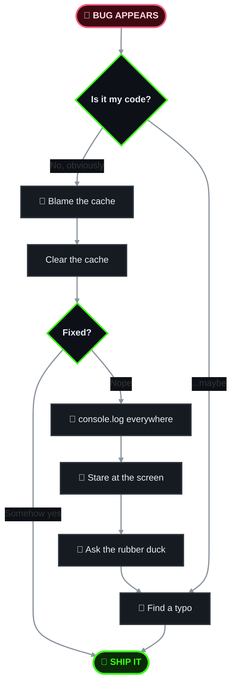

<div align="center">
  

  <a href="https://github.com/TanmayChauhan123">
    
  </a>

  <p>
    <a href="https://www.linkedin.com/in/YOUR_LINKEDIN"></a>
    <a href="mailto:YOUR_EMAIL"></a>
    <a href="https://YOUR_PORTFOLIO.com"></a>
    
  </p>
</div>

---

## 👋 About

Full-stack dev who likes AI, real-time apps, and shipping things.
Fueled by chai, stubbornness, and an unreasonable number of browser tabs.

<details>
<summary><b>🔍 Tell me more</b></summary>
<br>

- 🤖 Playing with **RAG** and **local LLMs**
- ⚡ Building **real-time** apps that don't fall over (usually)
- 🐳 Pretending to be a **DevOps** person on weekends
- 🌱 Currently learning: *agentic workflows*

</details>

<details>
<summary><b>🏅 Official certifications</b></summary>
<br>


</details>

---

## 🧰 Tech Stack

<div align="center">


</div>

---

## 🚀 Projects

> Pick your adventure. Click to expand.

<details>
<summary><b>🤖 AI & ML</b> &nbsp;·&nbsp; <i>"Teaching computers to think (sort of)"</i></summary>
<br>

| | Project | One-liner |
|:-:|:--|:--|
| 🧭 | [**RAG-Pilot**](https://github.com/TanmayChauhan123/RAG-Pilot) | A RAG system that decides how hard to think before answering |
| 🎓 | [**InsightPulse**](https://github.com/TanmayChauhan123/InsightPulse) | Predicts student performance and explains *why* |
| 💳 | [**Credit-Card-Fraud-Detection**](https://github.com/TanmayChauhan123/Credit-Card-Fraud-Detection) | Catches the bad transactions before they catch you |

</details>

<details>
<summary><b>🌐 Full-Stack Apps</b> &nbsp;·&nbsp; <i>"Buttons, databases, and vibes"</i></summary>
<br>

| | Project | One-liner |
|:-:|:--|:--|
| 🤝 | [**DevSync**](https://github.com/TanmayChauhan123/DevSync) | Kanban + chat + AI for teams that ship |
| ♟️ | [**ChessArena**](https://github.com/TanmayChauhan123/ChessArena) | Multiplayer chess with an AI coach that judges your moves |
| 🎟️ | [**QueueLess**](https://github.com/TanmayChauhan123/QueueLess) | Skip the line, keep your dignity |
| 🎤 | [**PrepForge**](https://github.com/TanmayChauhan123/PrepForge) | Interview prep with a local AI (no API bills) |
| 🧠 | [**HabitMind**](https://github.com/TanmayChauhan123/HabitMind) | A habit tracker that actually talks back |

</details>

<details>
<summary><b>⚙️ DevOps</b> &nbsp;·&nbsp; <i>"If it's not monitored, it's a rumor"</i></summary>
<br>

| | Project | One-liner |
|:-:|:--|:--|
| 🚨 | [**OpsPulse**](https://github.com/TanmayChauhan123/OpsPulse) | Watches your services so you can sleep (a little) |
| ☁️ | [**CloudBridge**](https://github.com/TanmayChauhan123/CloudBridge) | Docker + CI/CD, now with a dashboard |

</details>

---

## 🎮 Play With Me

<details>
<summary><b>♟️ Challenge me to chess</b></summary>
<br>

I built a whole chess platform, so naturally I'm overconfident.
👉 [**Open ChessArena**](https://github.com/TanmayChauhan123/ChessArena) and let's see who blunders first.

</details>

<details>
<summary><b>🤥 Two truths and a lie</b></summary>
<br>

1. I built a chess platform with a Stockfish-powered AI coach.
2. I trained a model to catch credit card fraud.
3. I have never debugged anything with `console.log`.

<details>
<summary>👀 Reveal the lie</summary>
<br>

**#3.** I have used `console.log("here")` approximately a million times. 🫠

</details>

</details>

<details>
<summary><b>🤔 Would you rather?</b></summary>
<br>

**Fix a bug in production on a Friday night** or **write documentation for a project with zero comments?**

<details>
<summary>My answer</summary>
<br>

Friday night bug. At least the pain has a deadline. 😭

</details>

</details>

<details>
<summary><b>🐛 How I debug</b></summary>
<br>



</details>

<details>
<summary><b>📊 Current status</b></summary>
<br>

```
☕ Coffee level   [##########  ]  85%
🐛 Bugs fixed     [########    ]  70%
🧠 Brain cells    [#####       ]  42%
😴 Sleep          [            ]  404 Not Found
```

</details>

<details>
<summary><b>🔴 Do NOT click this</b></summary>
<br>

I said don't. Fine, if you insist:
👉 [**Definitely not a rickroll**](https://www.youtube.com/watch?v=dQw4w9WgXcQ)

</details>

---

## 📊 GitHub Stats

<div align="center">
  
  <br><br>
  
  
</div>

---

## 📬 Contact

```bash
$ git commit -m "Let's work together"
$ git push origin YOUR_EMAIL
```

Open to internships, collabs, and bad puns. 🙌

<div align="center">
  <sub>⭐ A star makes my commit history feel less lonely.</sub>
  
</div>
