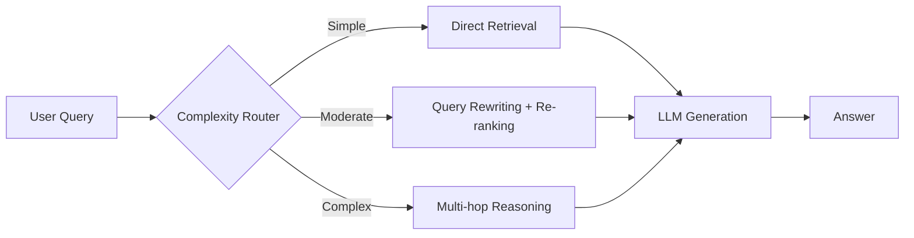
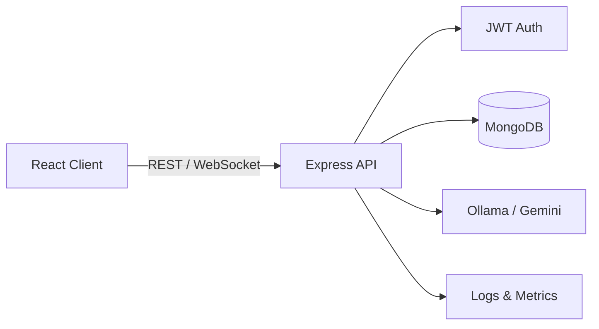

<!-- Animated header -->
<div align="center">
  

  <!-- Typing animation -->
  <a href="https://github.com/TanmayChauhan123">
    
  </a>

  <p>
    <a href="https://www.linkedin.com/in/tanmay-chauhan-388358281/"></a>
    <a href="mailto:tanmaychauhan2005@gmail.com"></a>
    <a href="https://YOUR_PORTFOLIO.com"></a>
    
  </p>
</div>

---

## `~/about`

```ts
const developer = {
  name: "YOUR NAME",
  role: "Full-Stack & AI Engineer",
  location: "Delhi, India",
  focus: ["RAG systems", "Real-time apps", "ML pipelines", "DevOps & observability"],
  currentlyLearning: ["Agentic workflows", "Advanced RAG", "Cloud-native architecture"],
  principles: [
    "Ship small, iterate fast",
    "Validate on the server, trust nothing from the client",
    "If it isn't monitored, it isn't done",
    "Prefer local-first AI where privacy and cost matter",
  ],
  openTo: ["Internships", "Collaborations", "Open source"],
};
```

---

## `~/stack`

<div align="center">

| Layer | Technologies |
|:--|:--|
| **Languages** |  |
| **Frontend** |  |
| **Backend** |  |
| **Database** |  |
| **AI / ML** |    |
| **DevOps** |  |

</div>

---

## `~/projects`

> Click a category to expand.

<details open>
<summary><b>🤖 AI & Machine Learning</b></summary>
<br>

| Project | What it does | Stack |
|:--|:--|:--|
| [**RAG-Pilot**](https://github.com/YOUR_USERNAME/RAG-Pilot) | Adaptive RAG that routes each query by complexity: simple retrieval, query rewriting with re-ranking, or multi-hop reasoning | `Python` `RAG` `LLM` |
| [**InsightPulse**](https://github.com/YOUR_USERNAME/InsightPulse) | Student performance prediction with explainable AI, RAG, and a locally hosted LLM | `Python` `ML` `XAI` `RAG` |
| [**Credit-Card-Fraud-Detection**](https://github.com/YOUR_USERNAME/Credit-Card-Fraud-Detection) | Fraud detection with Logistic Regression and Random Forest, class imbalance handling, and full model evaluation | `Jupyter` `scikit-learn` |

</details>

<details open>
<summary><b>🌐 Full-Stack Applications</b></summary>
<br>

| Project | What it does | Stack |
|:--|:--|:--|
| [**DevSync**](https://github.com/YOUR_USERNAME/DevSync) | Real-time collaborative project management: team workspaces, Kanban boards, chat, AI dev tools | `React` `Node.js` `WebSockets` |
| [**ChessArena**](https://github.com/YOUR_USERNAME/ChessArena) | Multiplayer chess with spectator mode, server-side move validation, Stockfish analysis, and an AI coach | `JavaScript` `WebSockets` `Stockfish` |
| [**QueueLess**](https://github.com/YOUR_USERNAME/QueueLess) | Digital tokens, live queue tracking, estimated wait times, and business queue management | `TypeScript` |
| [**PrepForge**](https://github.com/YOUR_USERNAME/PrepForge) | AI interview prep platform with JWT auth and local Ollama AI | `Node.js` `Express` `MongoDB` `Ollama` |
| [**HabitMind**](https://github.com/YOUR_USERNAME/HabitMind) | AI habit tracker with glassmorphism UI, light/dark mode, and Gemini-powered insights | `MERN` `Tailwind v4` `Gemini` |

</details>

<details open>
<summary><b>⚙️ DevOps & Observability</b></summary>
<br>

| Project | What it does | Stack |
|:--|:--|:--|
| [**OpsPulse**](https://github.com/YOUR_USERNAME/OpsPulse) | Real-time observability and incident management: app health, logs, metrics, and service failures | `Monitoring` `Logging` |
| [**CloudBridge**](https://github.com/YOUR_USERNAME/CloudBridge) | Deployment dashboard showing containerization, CI/CD automation, and deployment monitoring | `Docker` `CI/CD` |

</details>

---

## `~/architecture`

<details>
<summary><b>How RAG-Pilot routes queries</b></summary>



</details>

<details>
<summary><b>Typical full-stack AI app flow</b></summary>



</details>

---

## `~/stats`

<div align="center">
  
  
  <br>
  
  <br>
  
</div>

---

## `~/contact`

```bash
$ git remote add collab YOUR_EMAIL
$ echo "Open to internships, collaborations, and interesting problems."
```

<div align="center">
  <sub>⭐ If something here helped you, a star is always appreciated.</sub>
  
</div>
