 <div align="center">



<br/>

<a href="https://github.com/TanmayChauhan123">
  
</a>
<a href="https://www.linkedin.com/in/tanmay-chauhan-388358281/">
  
</a>
<a href="mailto:tanmaychauhan2005@gmail.com">
  
</a>
<a href="YOUR_PORTFOLIO_URL">
  
</a>

<br/>


</div>

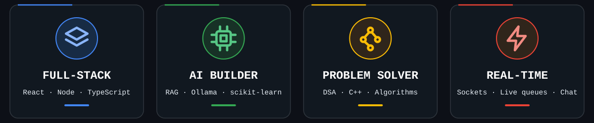

<br/>


I'm **Tanmay Chauhan**, a developer interested in building practical software solutions through full-stack development, artificial intelligence, and problem solving.

I enjoy exploring new technologies, understanding how systems work, and turning ideas into functional applications.

- 💻 **Full-Stack Development:** Building responsive applications and scalable backend systems.
- 🤖 **Artificial Intelligence:** Exploring Generative AI, RAG systems, and AI-powered applications.
- 🧩 **Problem Solving:** Strengthening data structures, algorithms, and computational thinking.
- ⚙️ **Engineering:** Focusing on clean code, system design, and practical implementation.

> **Learn continuously. Build thoughtfully. Improve consistently.**

<details>
<summary><b>More About Me</b></summary>
<br/>

- 🌱 **Currently exploring:** AI engineering, backend development, and system design.
- 🤝 **Interested in:** Open-source contributions, internships, and collaborative projects.
- 💬 **Technologies I work with:** React, Node.js, TypeScript, C++, Python, and databases.
- 🎯 **Current focus:** Building meaningful projects and improving my software engineering skills.

</details>

<br/>


<div align="center">

**Languages**
<br/>


<br/>

**Frontend Development**
<br/>


<br/>

**Backend & Databases**
<br/>


<br/>

**Tools & Platforms**
<br/>


<br/>

**AI & Problem Solving**
<br/>


</div>

<br/>


<div align="center">

<div align="center">

<a href="https://github.com/TanmayChauhan123/QueueLess">
  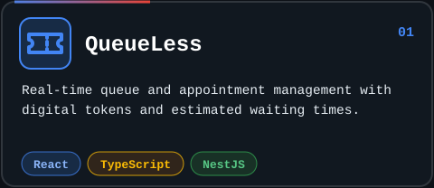
</a>
<a href="https://github.com/TanmayChauhan123/DevSync">
  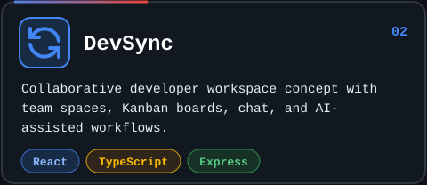
</a>
<a href="https://github.com/TanmayChauhan123/ChessArena">
  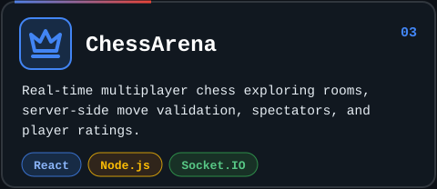
</a>
<a href="https://github.com/TanmayChauhan123/PrepForge">
  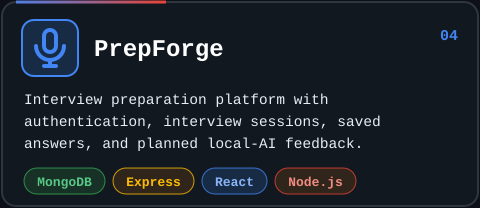
</a>
<a href="https://github.com/TanmayChauhan123/RAG-Pilot">
  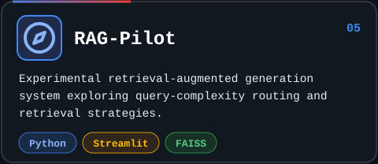
</a>
<a href="https://github.com/TanmayChauhan123/InsightPulse">
  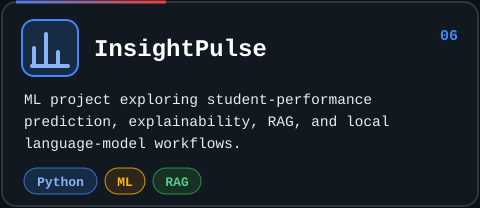
</a>
<a href="https://github.com/TanmayChauhan123/HabitMind">
  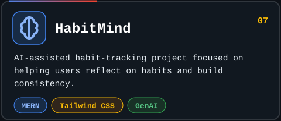
</a>
<a href="https://github.com/TanmayChauhan123/Credit-Card-Fraud-Detection">
  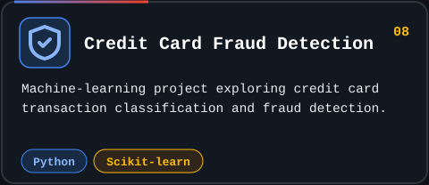
</a>

</div>

<br/><br/>

<a href="https://github.com/TanmayChauhan123?tab=repositories">
  
</a>

</div>

<br/>


<div align="center">


<br/><br/>
</div>

<br/>


<div align="center">


<picture>
  <source media="(prefers-color-scheme: dark)" srcset="https://raw.githubusercontent.com/TanmayChauhan123/TanmayChauhan123/output/snake-neon.svg">
  <source media="(prefers-color-scheme: light)" srcset="https://raw.githubusercontent.com/TanmayChauhan123/TanmayChauhan123/output/snake-light.svg">
  
</picture>


</div>

<br/>


```text
DEVELOPMENT / LEARNING ROADMAP

[01] Building full-stack applications
[02] Exploring Generative AI and RAG architectures
[03] Strengthening Data Structures and Algorithms
[04] Learning system design and backend engineering
[05] Contributing to practical and open-source projects
```

<br/>


<div align="center">

<a href="https://github.com/TanmayChauhan123">
  
</a>
<a href="https://www.linkedin.com/in/tanmay-chauhan-388358281/">
  
</a>
<a href="mailto:tanmaychauhan2005@gmail.com">
  
</a>

</div>


