 <div align="center">



<p>
  <a href="https://github.com/TanmayChauhan123"></a>
  <a href="https://www.linkedin.com/in/tanmay-chauhan-388358281/"></a>
  <a href="mailto:tanmaychauhan2005@gmail.com"></a>
  <a href="https://YOUR_PORTFOLIO_URL.example"></a>
  
</p>


</div>

<br>


I'm **Tanmay Chauhan**, a developer who enjoys building useful products, exploring AI, and learning how software works from frontend to backend.

- ⚡ **Full-stack:** building applications and real-time experiences.
- 🤖 **AI:** exploring RAG, local LLMs, and practical AI integrations.
- 🧩 **Problem solving:** practising data structures, algorithms, and logic.
- 🛠️ **Craft:** learning by building, debugging, shipping, and iterating.

> `BUILD → TEST → DEBUG → SHIP → REPEAT`

<details>
<summary><b>🔎 More about me</b></summary>
<br>

- 🌱 **Currently exploring:** AI-assisted workflows, backend architecture, and system design
- 🤝 **Interested in:** open-source projects, internships, and collaborative builds
- 💬 **Ask me about:** React, Node.js, TypeScript, APIs, and my projects
- 🎯 **Current goal:** turning side projects into polished, production-minded applications

</details>

<br>


<div align="center">

**💻 Languages**<br>


**🎨 Frontend**<br>


**⚙️ Backend and databases**<br>


**🧰 Tools and platforms**<br>


**🧠 AI and problem solving**<br>


</div>

<br>


<div align="center">
<br><br>
<a href="https://github.com/TanmayChauhan123?tab=repositories"></a>
</div>

<br>


<div align="center">


<br/>


<br/>
</div>

<br>


<div align="center">
<picture>
  <source media="(prefers-color-scheme: dark)" srcset="https://raw.githubusercontent.com/TanmayChauhan123/TanmayChauhan123/output/snake-neon.svg">
  <source media="(prefers-color-scheme: light)" srcset="https://raw.githubusercontent.com/TanmayChauhan123/TanmayChauhan123/output/snake-light.svg">
  
</picture>
</div>

<br>


```text
LOOPZERO / CURRENT FOCUS
[01] Shipping polished full-stack features
[02] Strengthening backend design and API reliability
[03] Experimenting with RAG and local AI workflows
[04] Practising DSA and improving problem-solving
```

<br>


<div align="center">
<a href="https://github.com/TanmayChauhan123"></a>
<a href="https://www.linkedin.com/in/tanmay-chauhan-388358281/"></a>
<a href="mailto:tanmaychauhan2005@gmail.com"></a>
</div>


